## Hi, I'm Oshani Hind

**Computer Science & AI undergraduate at NIBM** · passionate about tech & robotics

I enjoy building interactive web experiences and clean, user-friendly interfaces — from UI design in Figma to working front-ends in HTML, CSS, JavaScript and React.

---

### Featured project

**[Welcome to My Little World](https://github.com/HINDELGIRIYAGE/WELCOME-TO-MY-little-WorlD)** — my name written in stardust, controlled with hand gestures through the webcam (MediaPipe hand tracking, Canvas particle system, mini games).
[Live demo](https://hindelgiriyage.github.io/WELCOME-TO-MY-little-WorlD/)

### Tech stack

