<!-- ============================================================
     HERO — terminal banner (assets/banner.svg)
     ============================================================ -->

  

 

## `> about_me`

I'm **Oshani Hind Elgiriyage**, a BSc Computer Science & Artificial Intelligence undergraduate at **NIBM, Sri Lanka**, and an aspiring software developer.

I focus on **frontend development** — designing clean, user-friendly interfaces in Figma and building them with HTML, CSS, JavaScript and React. I'm also interested in AI, robotics and software engineering, and I'm always learning something new.

 

## `> tech_stack`

<table>
  <tr>
    <td width="130"><b>Frontend</b></td>
    <td></td>
  </tr>
  <tr>
    <td><b>Programming</b></td>
    <td></td>
  </tr>
  <tr>
    <td><b>Tools</b></td>
    <td></td>
  </tr>
  <tr>
    <td><b>Interests</b></td>
    <td><code>Artificial Intelligence</code> <code>Machine Learning</code> <code>Robotics</code> <code>UI/UX Design</code></td>
  </tr>
</table>

 

## `> featured_projects`

<table>
  <tr>
    <td>
      <h3><a href="https://github.com/HINDELGIRIYAGE/WELCOME-TO-MY-little-WorlD">Welcome to My Little World</a></h3>
      
An interactive web experience where a name is written in glowing stardust and controlled with hand gestures through the webcam — with a terminal-style intro, two themes and three built-in mini games.

      
<code>HTML</code> <code>CSS</code> <code>JavaScript</code> <code>Canvas 2D</code> <code>MediaPipe</code> <code>Web Audio API</code>

      

        <a href="https://github.com/HINDELGIRIYAGE/WELCOME-TO-MY-little-WorlD">Repository</a>&nbsp;&nbsp;·&nbsp;&nbsp;
        <a href="https://hindelgiriyage.github.io/WELCOME-TO-MY-little-WorlD/">Live demo</a>
      

    </td>
  </tr>
</table>

<!-- ADD MORE PROJECTS: copy this block inside the table above, then fill it in.
  <tr>
    <td>
      <h3><a href="https://github.com/HINDELGIRIYAGE/REPO-NAME">Project Name</a></h3>
      
One or two sentences on what it does and who it is for.

      
<code>Tech</code> <code>Tech</code> <code>Tech</code>

      
<a href="https://github.com/HINDELGIRIYAGE/REPO-NAME">Repository</a>

    </td>
  </tr>
-->

 

## `> github_stats`

  
  

  

 

## `> connect`

  
  <!-- LinkedIn: replace YOUR-LINKEDIN-ID, then remove these comment marks
  
  -->
  <!-- Email: replace you@example.com, then remove these comment marks
  
  -->
  <!-- Portfolio: replace the URL, then remove these comment marks
  
  -->

